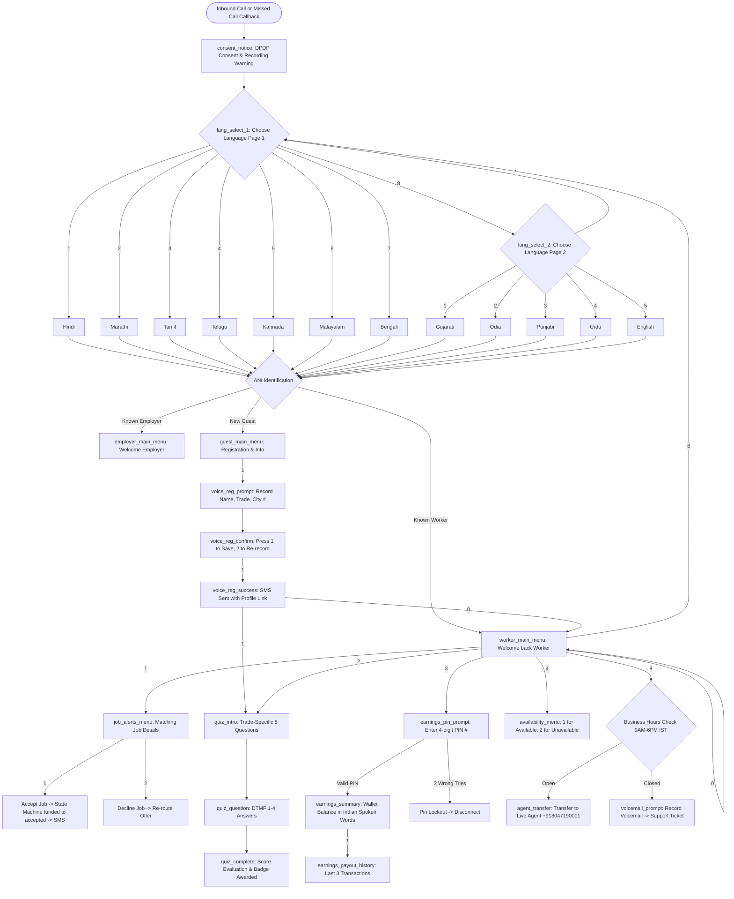

# SkillBridge Production Telephony IVR System

Production-grade, provider-agnostic, webhook-driven interactive voice response (IVR) telephony architecture built for India's 500 million informal workers. Designed specifically for keypad (feature) phones without internet or touchscreens.

---

## 1. Call-Flow Architecture Diagram (Mermaid)



---

## 2. Standard Keypad Map Everywhere

| Key | Global Function | Behavior |
|:---:|:---|:---|
| **`0`** | **Repeat Prompt** | Replays the current menu prompt without resetting session state. |
| **`*`** | **Back / Previous Menu** | Navigates back one step in the menu hierarchy. |
| **`#`** | **Confirm / Finish Input** | Submits variable-length PIN or signals end of voice recording. |
| **`8`** | **Change Language** | Instantly jumps to the 12-language selection menu. |
| **`9`** | **Support / Agent Help** | Checks business hours (9 AM - 6 PM IST, Mon-Sat). Dials agent or takes voicemail. |

---

## 3. Real Provider Setup Guides

SkillBridge runs with an abstraction layer (`TelephonyProvider`) allowing seamless switching between **Simulator**, **Exotel**, and **Twilio** via the `TELEPHONY_PROVIDER` environment variable.

### Exotel Integration (Recommended for India)
1. **Purchase Virtual DID / Toll-Free Number**:
   - Log into your [Exotel Dashboard](https://my.exotel.com/).
   - Navigate to **Numbers** > **Buy Number** (pick an Indian virtual landline e.g., `080-47190000` or `1800-889-2026`).
2. **Configure Webhook Passthru Applet**:
   - Go to **Applets** > **Create Flow** > Add **Passthru Applet**.
   - Set HTTP Method: `POST`.
   - Set URL: `https://<YOUR_PUBLIC_DOMAIN>/api/v1/ivr/incoming`.
3. **Configure Status & Missed Call Webhooks**:
   - Under Phone Number settings > **Call End Webhook**: `https://<YOUR_PUBLIC_DOMAIN>/api/v1/ivr/status`.
   - Under Missed Call settings: `https://<YOUR_PUBLIC_DOMAIN>/api/v1/ivr/missed-call`.
4. **Environment Configuration**:
   ```env
   TELEPHONY_PROVIDER=exotel
   IVR_INBOUND_NUMBER=+918047190000
   IVR_TOLL_FREE_NUMBER=1800-889-2026
   TELEPHONY_ACCOUNT_SID=your_exotel_sid
   TELEPHONY_AUTH_TOKEN=your_exotel_token
   TELEPHONY_WEBHOOK_SECRET=your_webhook_signature_secret
   PUBLIC_BASE_URL=https://<YOUR_PUBLIC_DOMAIN>
   ```

### Twilio Integration (Global / Fallback)
1. **Purchase Phone Number**:
   - In Twilio Console, buy an SMS and Voice enabled phone number.
2. **Configure Webhook URLs (Voice & TwiML)**:
   - Under **A Call Comes In**: Select `Webhook`, `HTTP POST`, set to:
     `https://<YOUR_PUBLIC_DOMAIN>/api/v1/ivr/incoming`
   - Under **Call Status Changes**: Set to:
     `https://<YOUR_PUBLIC_DOMAIN>/api/v1/ivr/status`
3. **Environment Configuration**:
   ```env
   TELEPHONY_PROVIDER=twilio
   IVR_INBOUND_NUMBER=+12025550199
   TELEPHONY_ACCOUNT_SID=ACxxxxxxxxxxxxxxxxxxxxxxxxxxxxxxxx
   TELEPHONY_AUTH_TOKEN=your_twilio_auth_token
   PUBLIC_BASE_URL=https://<YOUR_PUBLIC_DOMAIN>
   ```

---

## 4. Keypad Phone Testing Checklist

Use a basic Nokia 105, JioPhone, or Samsung Guru feature phone to test the live line:

- [ ] **Dual Tone Multi-Frequency (DTMF)**: Pressing `1` through `9` executes immediately while prompt is playing (barge-in enabled).
- [ ] **Volume & Compression**: Spoken prompts are normalized at 8 kHz mono and audible through low-cost phone ear speakers.
- [ ] **Missed-Call Flow**: Dial the toll-free number, let it ring once, then disconnect. Verify automated callback arrives within 30 seconds.
- [ ] **Universal Keys**: Press `0` to repeat prompt; press `8` to switch between Hindi, Marathi, and Tamil; press `*` to go back.
- [ ] **Audio Registration**: Record name, skill, experience, and city after the beep; verify that Gemini voice engine registers the profile and sends an SMS receipt.
- [ ] **PIN Protection**: Access earnings (Option 3); enter incorrect PIN 3 times; verify session locks out and terminates cleanly.
- [ ] **Real Earnings**: Enter correct 4-digit PIN; verify real ledger balance is read aloud with Indian numbering (e.g. "तीन हज़ार चार सौ रुपये").

---

## 5. Regulatory Compliance Checklist (TRAI, DLT & DPDP Act 2023)

- [ ] **Calling Hours Enforcement**: Outbound calls and callbacks are strictly restricted to **9:00 AM to 9:00 PM IST**. Calls requested after 9 PM are automatically scheduled for 9:00 AM the following morning.
- [ ] **Do-Not-Call (DNC) Registry**: Automated verification against `ivr_dnc_list` prior to placing any outbound call.
- [ ] **Daily Callback Cap**: Max 5 outbound automated callbacks per telephone number per calendar day.
- [ ] **TRAI DLT Registration**: All SMS messages include approved Principal Entity ID (`110155223344`) and Sender Header (`SKLBRG`).
- [ ] **Mandatory Consent Notice**: Every call begins with the DPDP-compliant notice: *"This call may be recorded for quality and safety."*
- [ ] **PII & Data Minimization**: Caller phone numbers are masked in all administrative dashboards and logs (e.g., `+91 9822****2345`). Voice recordings are purged after 90 days.
